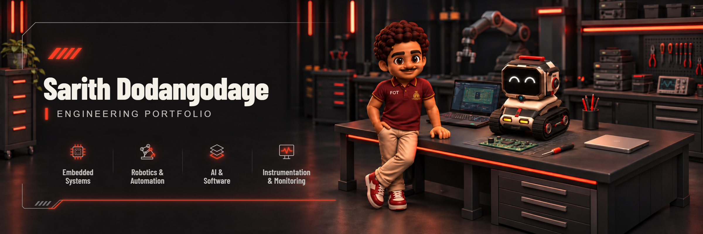
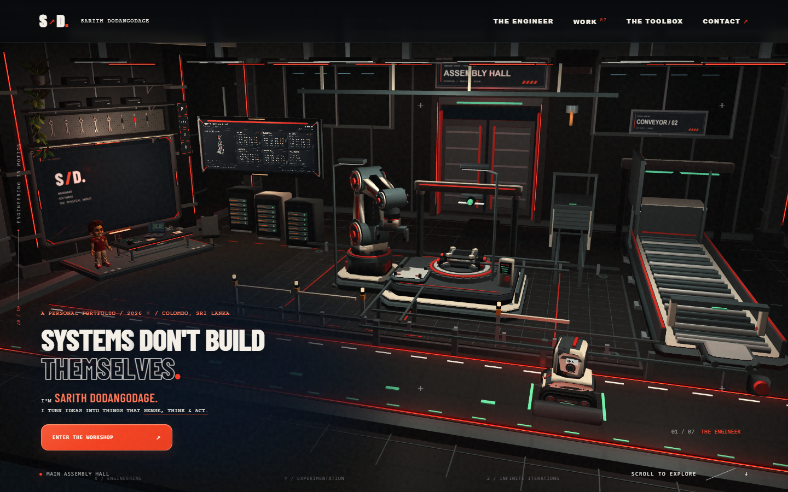
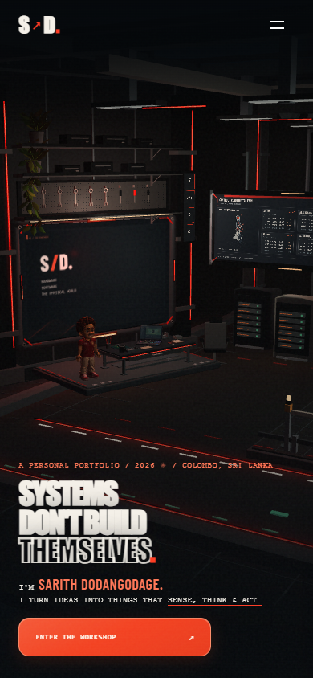
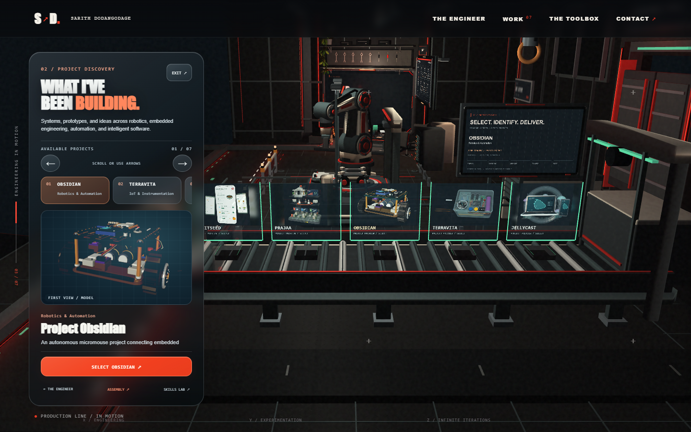
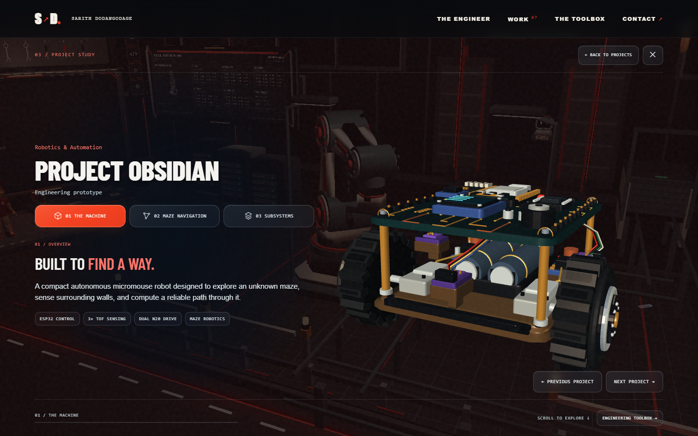
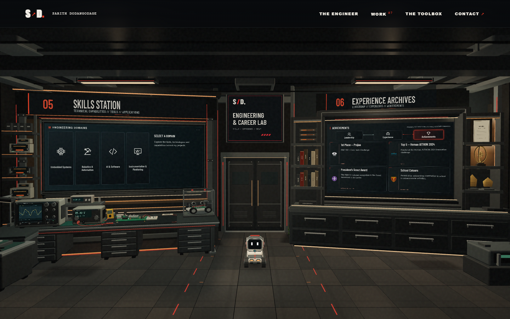

An interactive 3D engineering portfolio built as a virtual workshop, showcasing projects in robotics, embedded systems, automation, AI, and software engineering.

**[Explore the live portfolio →](https://portfolio-bu2.pages.dev/)** · [Browse the source](https://github.com/xari-ya/Portfolio)

## Inside the workshop

The portfolio turns project exploration into a journey through an engineering workshop. A working assembly line, an engineer’s workbench, and a shared 3D environment connect the projects, background, skills, and contact areas. Selecting a project sends it through the production line before opening its individual study.

Desktop and mobile have their own responsive compositions and controls. Project chapters pair technical descriptions with interactive models, while HTML provides the reading surfaces, navigation, and an illustrated fallback when WebGL is unavailable.

## Experience showcase



<p align="center">
  
</p>

<details>
<summary>Project Discovery, a project study, and the Engineering &amp; Career Lab</summary>





</details>

These are captures of the running production build at **1440 × 900** and **390 × 844**. [Screenshot index and mobile views](docs/media/README.md).

## Explore the workshop

| Area | What to explore |
| --- | --- |
| **Main Assembly Hall** | The workshop entrance, working assembly cell, conveyor, and Kira. |
| **The Engineer** | The engineer’s workbench, introduction, education, interests, and direction. |
| **Project Discovery** | Browse seven projects and select one for delivery and inspection. |
| **Project Study** | Three chapters per project, with technical information, models, and project-specific controls. |
| **Engineering & Career Lab** | The Toolbox’s embedded systems, robotics, design, and software categories; archives for leadership, experience, and achievements. |
| **Communications / Contact** | Existing contact links and a downloadable résumé. |

## Featured engineering projects

| Project | Focus |
| --- | --- |
| **Project Obsidian** | Autonomous micromouse work combining ESP32 control, sensor feedback, navigation, and a Webots / ROS 2 simulation counterpart. |
| **TerraVita** | Compost-monitoring instrumentation using an ESP32-C3, environmental sensors, embedded electronics, and data monitoring. |
| **JellyCast** | Research into jellyfish abundance forecasting and coastal decision support for Sri Lanka’s western coastline. |
| **Analog FSK / IR** | A microcontroller-free infrared communication system using discrete analog electronics and dedicated circuit boards. |
| **Click Claim** | A three-person insurance incident and field-inspection project, including database engineering, reporting, and backend integration. |
| **HabitSeed** | A native Android habit-tracking app with plant growth, streaks, rewards, and social features. |
| **Prajaa** | A team concept for local-government transparency, representative information, and citizen participation. |

## Technology and architecture

| Layer | Implementation |
| --- | --- |
| **Interface** | HTML, CSS, and JavaScript; responsive desktop and mobile layouts. |
| **Rendering** | Custom WebGL 2 rendering, procedural geometry, shaders, and imported model assets. |
| **Interaction** | Shared journey navigation, assembly and delivery controllers, project chapters, orbit controls, and touch interaction. |
| **Build** | Node.js scripts assemble an explicit static asset allowlist into `dist/`. |
| **Verification** | Node.js controller tests and Playwright browser, interaction, and touch checks. |
| **Hosting** | Cloudflare Pages, connected to the GitHub production branch. |

The renderer and scene controllers are implemented directly in JavaScript. The site has no runtime npm dependencies.

Useful source entry points: [engine](engine.js), [project registry](project-registry.js), [project studies](project-study.js), [workshop systems](workshop-system.js), and [build](tools/build.mjs).

## Run locally

Use **Node.js 22 or newer**; the production setup uses Node.js 24.

```sh
git clone https://github.com/xari-ya/Portfolio.git
cd Portfolio
npm ci
npm start
```

Open **http://127.0.0.1:4173/**. To build and serve the production output:

```sh
npm run build
npm run preview
```

Open **http://127.0.0.1:4174/**. With that preview running, the existing checks are:

```sh
npm run check
npm test
npm run audit:release
npm run test:release
```

Browser checks use an installed Chromium, Chrome, or Edge. If none is available, run `npx playwright install chromium`. On Windows, the validated hardware backend can be selected in PowerShell with `$env:WORKSHOP_BROWSER_ANGLE='d3d11'`. [Verification and deployment details](release/DEPLOYMENT.md).

## Deployment

The live portfolio is deployed through Cloudflare Pages from **`release/production`**. The build command is **`npm run build`**, and the output directory is **`dist`**. Only the runtime asset allowlist is deployed; repository documentation and verification captures stay outside the website build.

Sharing metadata uses **https://portfolio-bu2.pages.dev/** and the approved 1200 × 630 artwork. `SITE_ORIGIN` can override that origin after a replacement domain is connected and verified. **`sarith.me` is planned; it is not used as the live URL here.** [Publication and rollback procedure](release/DEPLOYMENT.md).

## Explore and connect

[Enter the workshop](https://portfolio-bu2.pages.dev/) and use its Contact interface to get in touch.

Source and artwork retain their existing ownership and third-party terms. [Asset credits](https://portfolio-bu2.pages.dev/credits.html).
